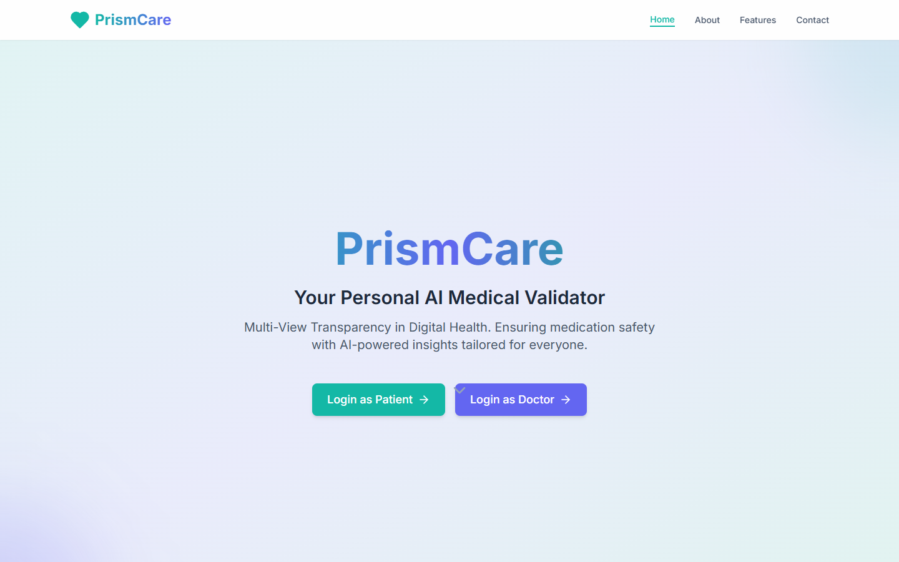
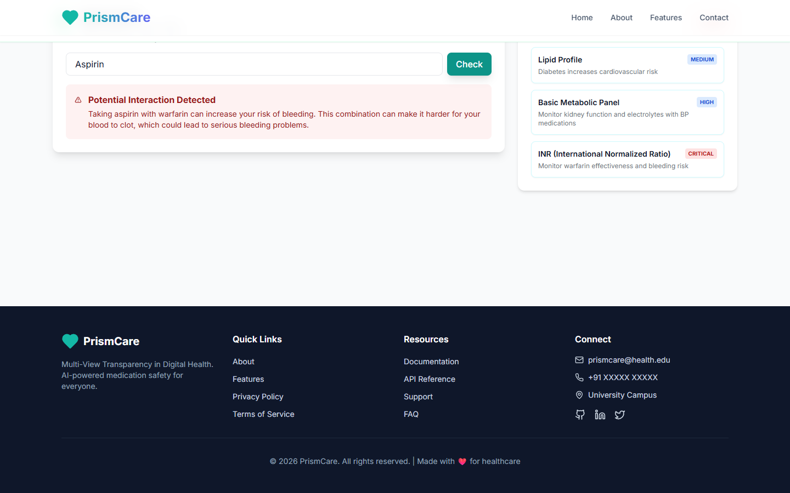
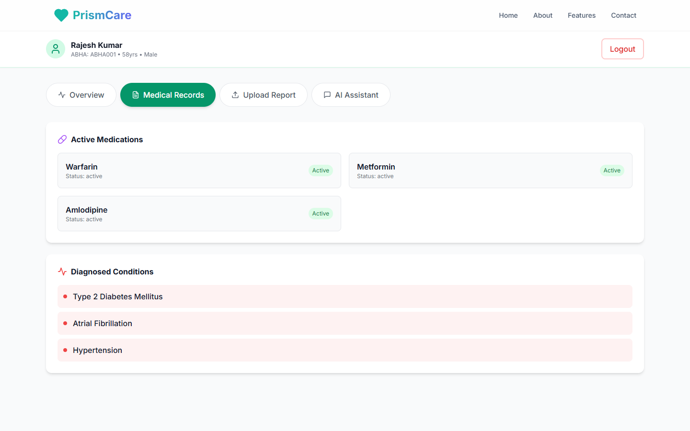
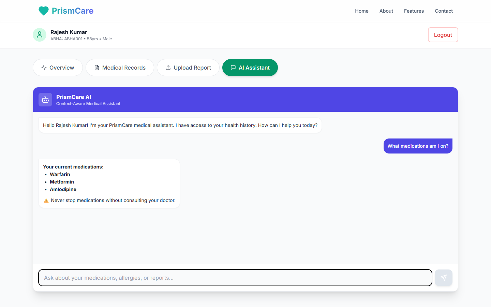
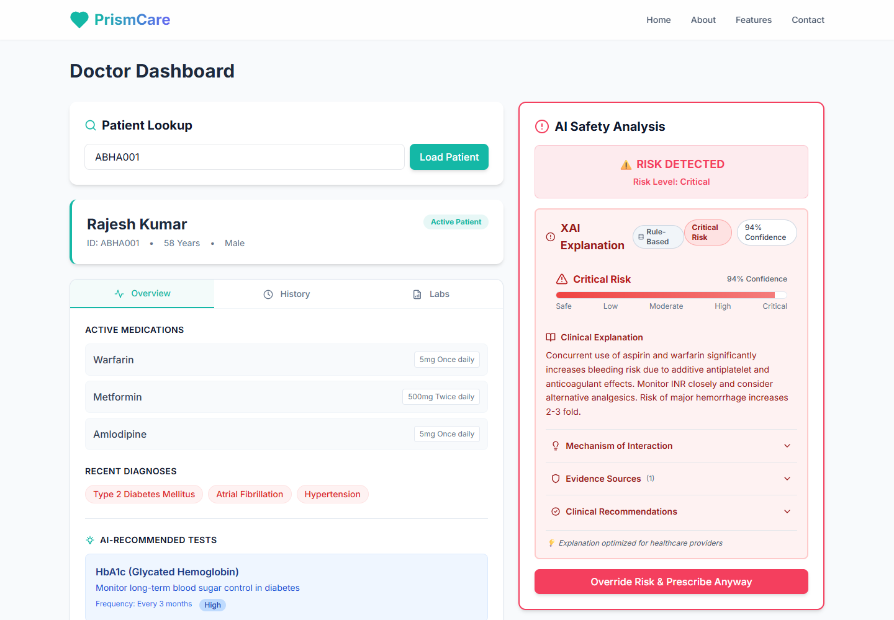
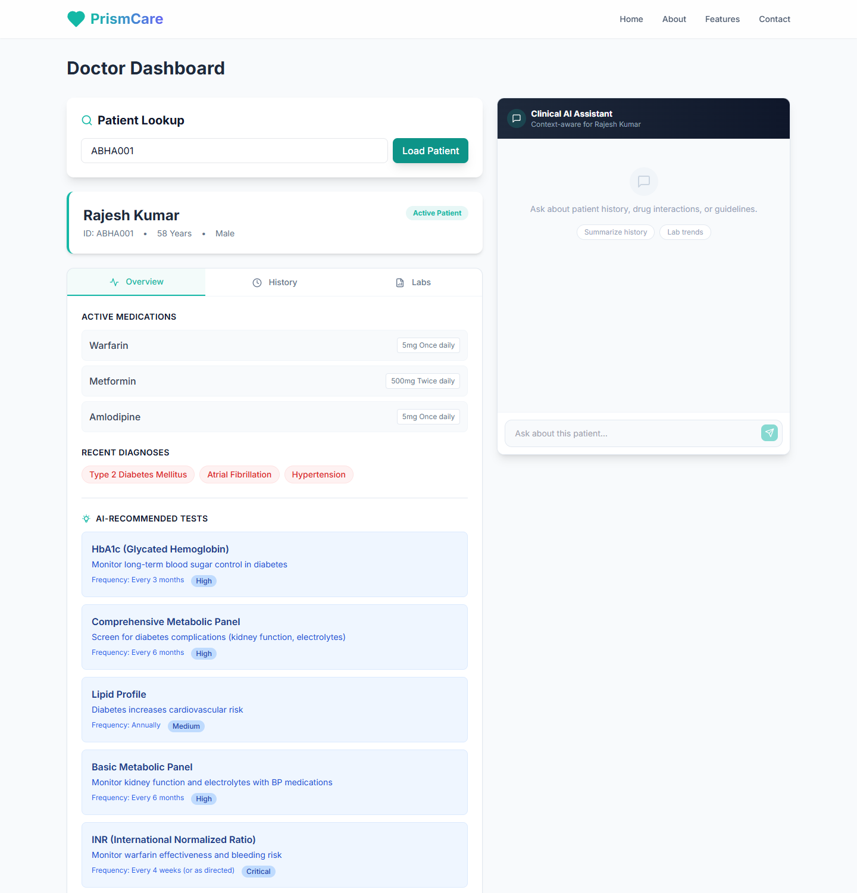
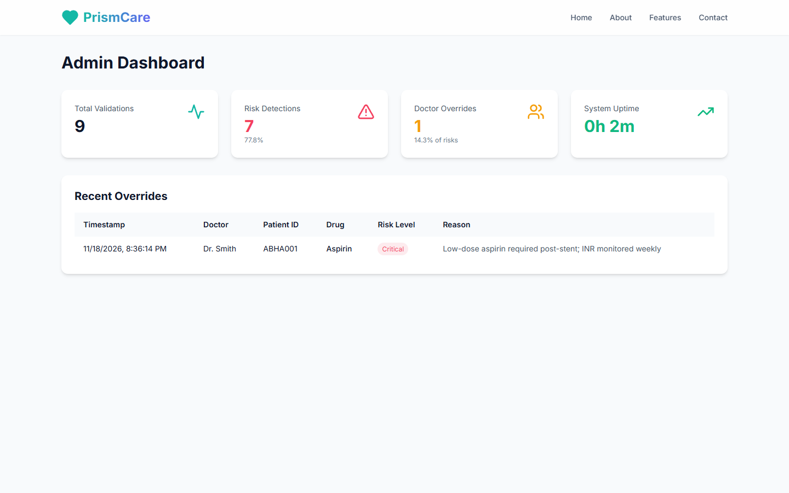
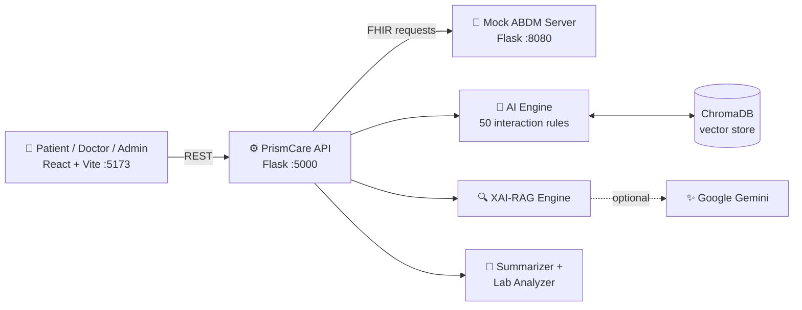

<div align="center">

# 💊 PrismCare

### AI Medical Validator: Multi-View Transparency in Digital Health

Before a new medicine is taken or prescribed, PrismCare checks it against the patient's full medical history and explains the risk in language that fits each reader: plain English for patients, clinical detail for doctors, and audit numbers for administrators.




</div>

---

## 📑 Table of Contents

- [Why PrismCare?](#-why-prismcare)
- [Screenshots](#-screenshots)
- [Features](#-features)
- [Architecture](#%EF%B8%8F-architecture)
- [Getting Started](#-getting-started)
- [Try It Out](#-try-it-out)
- [API Reference](#-api-reference)
- [Project Structure](#-project-structure)
- [Tech Stack](#-tech-stack)
- [License](#license)

---

## 🤔 Why PrismCare?

Drug interactions are a leading cause of preventable harm, and the same warning means different things to different people. A patient needs to know *"this could make you bleed more, talk to your doctor"*. A doctor needs the mechanism, the evidence level and the guideline source. An administrator needs to know how often warnings fire and how often doctors override them.

PrismCare gives each of them their own view of the same AI decision. It pulls the patient's records from an ABDM-style (Ayushman Bharat Digital Mission) FHIR server, so the check uses their real conditions, allergies and current medicines rather than the new drug alone.

---

## 📸 Screenshots

### 🧑 Patient view

| Health summary + instant safety check | Medical records |
|:---:|:---:|
|  |  |
| Checking **Aspirin** for a patient on **Warfarin** gives a plain-language bleeding-risk warning. | Active medications and diagnosed conditions from the ABDM record. |

<p align="center">
  <br>
  <em>Context-aware AI assistant that already knows the patient's history</em>
</p>

### 🩺 Doctor view

<p align="center">
  <br>
  <em>Explainable AI (XAI) safety analysis: risk level, confidence, clinical explanation, mechanism, evidence sources, and an override option that requires a written reason</em>
</p>

<details>
<summary><b>More: full doctor dashboard with AI-recommended tests</b></summary>
<br>
<p align="center">
  
</p>
</details>

### 🛡️ Admin view

<p align="center">
  <br>
  <em>Validation statistics, risk-detection rate and a full audit log of doctor overrides</em>
</p>

---

## ✨ Features

<table>
<tr>
<td width="33%" valign="top">

### 🧑 For Patients
- Login with an ABHA ID
- AI health summary of conditions and medicines
- One-box medicine safety check
- Jargon-free explanations
- Lab report upload and AI analysis
- AI assistant chat

</td>
<td width="33%" valign="top">

### 🩺 For Doctors
- Patient lookup with full history and labs
- Prescribe and analyze before prescribing
- XAI panel with risk gauge, confidence, mechanism and sources
- AI-recommended tests and evidence-graded treatment suggestions
- Clinical AI assistant
- Override with a written justification

</td>
<td width="33%" valign="top">

### 🛡️ For Admins
- Total validations and risk-detection rate
- Override rate tracking
- Audit log: who overrode what, for whom, and why
- Server uptime

</td>
</tr>
</table>

### 🧠 Under the hood

- **50 curated drug-interaction rules** (11 Critical, 20 High, 19 Moderate) with mechanisms and guideline sources, stored in **ChromaDB** for semantic retrieval
- **Context-aware checks**: interactions are checked against current medicines, **allergies** and **existing conditions**
- **XAI-RAG engine**: retrieves the matching rules and, when a Gemini key is set, generates the explanation with **Google Gemini**. Without a key it falls back to rule-based explanations, so the app still works offline.
- **FHIR-style mock ABDM server** with 5 realistic patients, including lab reports, diagnoses, procedures and visits

---

## 🏗️ Architecture



---

## 🚀 Getting Started

### Prerequisites

- **Python** 3.9 or newer
- **Node.js** 18 or newer

### 1. Clone

```bash
git clone https://github.com/ARyan-PAnDeyy/Prism-Care.git
cd Prism-Care/Prism-care-main
```

### 2. Backend

```bash
cd backend
pip install -r requirements.txt

# Optional: enables LLM-powered explanations and summaries
cp .env.example .env     # then add your API keys
```

| Variable | Required | Purpose |
|---|---|---|
| `GEMINI_API_KEY` | Optional | XAI explanations and lab analysis via Gemini ([get a free key](https://aistudio.google.com/app/apikey)) |
| `OPENROUTER_API_KEY` | Optional | LLM-written patient summaries |
| `USE_LLM` | Optional | `true` / `false` |

> Without any keys the app runs fully on its rule-based engine.

### 3. Start the servers (3 terminals)

```bash
# Terminal 1: Mock ABDM health-records server  →  http://localhost:8080
cd backend
python mock_abdm_server_enhanced.py

# Terminal 2: Main API server  →  http://localhost:5000
cd backend
python app_enhanced.py

# Terminal 3: Frontend  →  http://localhost:5173
cd frontend
npm install
npm run dev
```

Then open **http://localhost:5173** 🎉

---

## 🧪 Try It Out

### Sample patients (ABHA IDs)

| ABHA ID | Patient | Active medicines | Conditions |
|---|---|---|---|
| `ABHA001` | Rajesh Kumar, 58 M | Warfarin, Metformin, Amlodipine | Type 2 Diabetes, Atrial Fibrillation, Hypertension |
| `ABHA002` | Priya Sharma, 42 F | Lisinopril, Atorvastatin | Hypertension, Hyperlipidemia, Vitamin D Deficiency |
| `ABHA003` | Mohammed Ali, 35 M | none | Chronic Lower Back Pain |
| `ABHA004` | Sunita Devi, 65 F | Glimepiride, Levothyroxine, Glucosamine | Osteoarthritis, Type 2 Diabetes, Hypothyroidism |
| `ABHA005` | Amit Patel, 28 M | Cetirizine | Seasonal Allergic Rhinitis |

### Scenarios

| Role | Steps | Expected |
|---|---|---|
| 🧑 Patient | `/patient` → login `ABHA001` → check **Aspirin** | 🔴 Bleeding-risk warning (Aspirin + Warfarin) |
| 🧑 Patient | `/patient` → login `ABHA002` → check **Paracetamol** | 🟢 Safe |
| 🩺 Doctor | `/doctor` → load `ABHA001` → analyze **Aspirin** | Critical risk with full XAI explanation and an override option |
| 🛡️ Admin | `/admin` | Live stats and the override audit log |

---

## 📡 API Reference

### Main API (port 5000)

| Method | Endpoint | Description |
|---|---|---|
| `GET` | `/api/health` | Health check |
| `GET` | `/api/patient/<abha_id>` | Full patient record (preprocessed) |
| `GET` | `/api/patient/<abha_id>/summary` | AI health summary |
| `GET` | `/api/patient/<abha_id>/test-recommendations` | Recommended lab tests |
| `GET` | `/api/patient/<abha_id>/treatment-suggestions?diagnosis=<name>` | Evidence-graded treatments |
| `POST` | `/api/patient/<abha_id>/upload-lab` | Upload and analyze a lab report |
| `POST` | `/api/check-safety` | Drug safety check `{abha_id, medicine}` |
| `POST` | `/api/xai/explain` | Explainable risk analysis `{abha_id, medicine}` |
| `POST` | `/api/chat` | Context-aware assistant `{abha_id, query, history}` |
| `POST` | `/api/admin/override` | Log a doctor override |
| `GET` | `/api/admin/stats` | Dashboard statistics and recent overrides |
| `GET` | `/api/stats` | Raw usage counters |

### Mock ABDM server (port 8080)

| Method | Endpoint | Description |
|---|---|---|
| `GET` | `/fhir/Patient?identifier=<id>` | Demographics |
| `GET` | `/fhir/MedicationRequest?patient=<id>` | Medications |
| `GET` | `/fhir/Condition?patient=<id>` | Diagnoses |
| `GET` | `/fhir/DiagnosticReport?patient=<id>` | Lab reports |
| `GET` | `/fhir/Procedure?patient=<id>` | Procedures |
| `GET` | `/fhir/Encounter?patient=<id>` | Visits |

<details>
<summary><b>Example: safety check with curl</b></summary>

```bash
curl -X POST http://localhost:5000/api/check-safety \
  -H "Content-Type: application/json" \
  -d '{"abha_id": "ABHA001", "medicine": "Aspirin"}'
```

```json
{
  "status": "Risky",
  "risk_level": "Critical",
  "recommendation": "Avoid combination if possible. If necessary, use lowest effective aspirin dose and monitor INR weekly.",
  "source": "FDA Drug Interaction Database - Anticoagulant Guidelines 2025"
}
```
</details>

---

## 📂 Project Structure

```
Prism-care-main/
├── backend/
│   ├── app_enhanced.py               # Main Flask API (port 5000)
│   ├── mock_abdm_server_enhanced.py  # FHIR mock health-records server (port 8080)
│   ├── ai_engine_enhanced.py         # 50 interaction rules + ChromaDB retrieval
│   ├── xai_rag_engine.py             # Explainable AI (RAG + optional Gemini)
│   ├── ai_summarizer.py              # Patient health summaries
│   ├── lab_analyzer.py               # Lab report analysis
│   ├── data_preprocessor.py          # Cleans and deduplicates FHIR data
│   ├── requirements.txt
│   └── .env.example
└── frontend/
    └── src/
        ├── pages/                    # Landing, Patient, Doctor, Admin, About, Features, Contact
        └── components/               # XAIExplanationPanel, RiskGauge, FormattedText, Card, Button…
```

---

## 🛠️ Tech Stack

| Layer | Technologies |
|---|---|
| **Frontend** | React 18, Vite, Tailwind CSS, Framer Motion, Recharts, React Router, Axios, Lucide icons |
| **Backend** | Python, Flask, Flask-CORS |
| **AI / ML** | ChromaDB (vector search), Google Gemini (optional), OpenRouter (optional), RAG-based XAI |
| **Health data** | FHIR-style resources modelled on ABDM |

---

## 🚧 Roadmap

- [ ] Real drug database integration
- [ ] Authentication for doctors and admins
- [ ] Dark mode
- [ ] Multi-language explanations (Hindi and regional languages)
- [ ] Voice input and QR-code ABHA scan
- [ ] PWA / offline support

---

## License

This repository is under a proprietary license.

All rights are reserved. You may NOT:
- Copy, redistribute, or sublicense the code.
- Modify, adapt, or create derivative works.
- Use this code for commercial purposes.

Permission to use, modify, or redistribute this code may only be granted explicitly in writing by the copyright holder.

See the [LICENSE](./LICENSE) file for full details.

---

## 🙏 Acknowledgments

- ABDM (Ayushman Bharat Digital Mission) for healthcare data standards
- Medical guidelines from FDA, AHA/ACC and the Endocrine Society
- Open-source libraries: React, Flask, ChromaDB, Tailwind CSS

> ⚠️ **Disclaimer:** PrismCare is a research and educational project. It is not a medical device and must not replace professional medical advice.

<div align="center">

**Made with ❤️ for healthcare**

</div>
